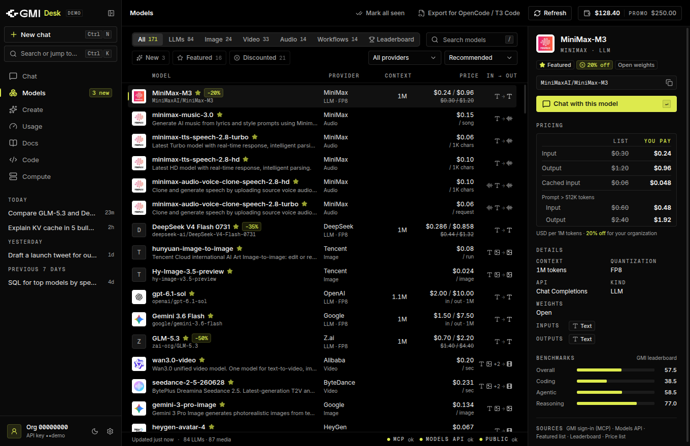
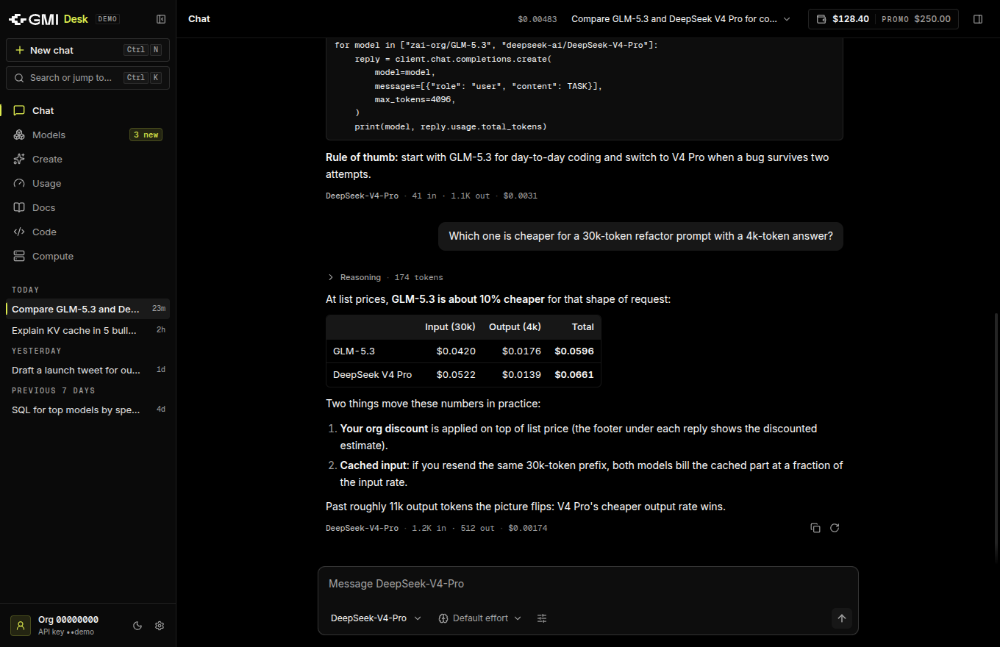
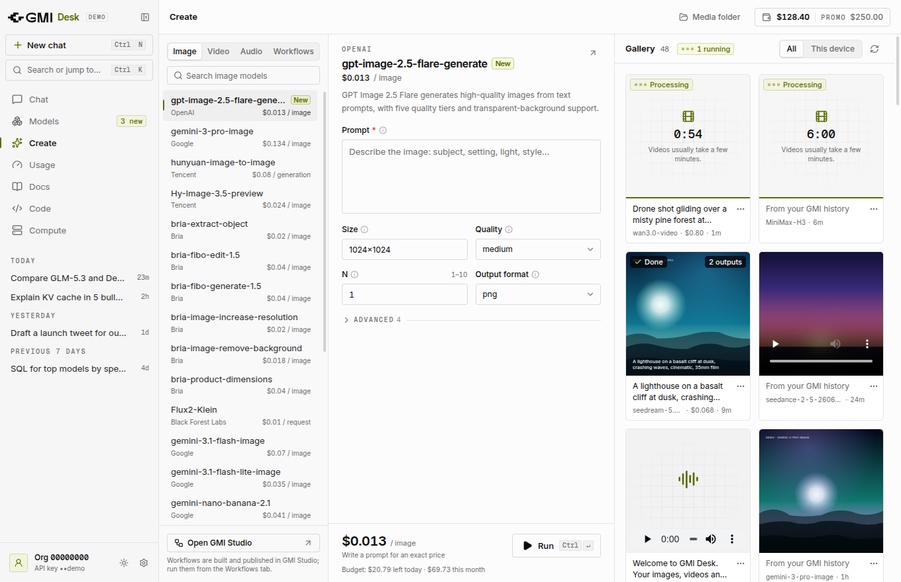
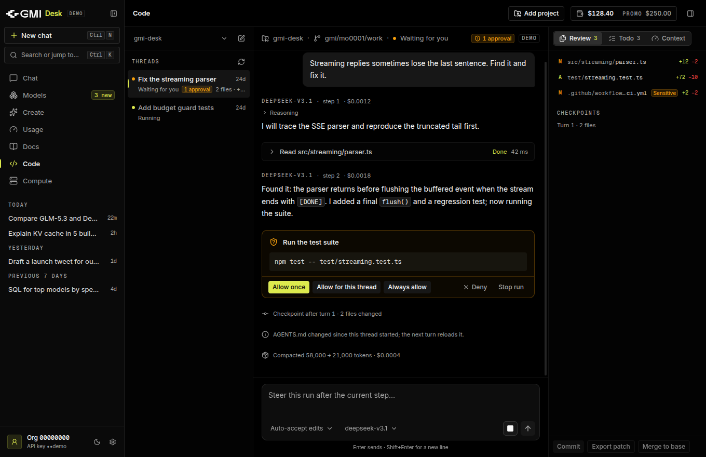
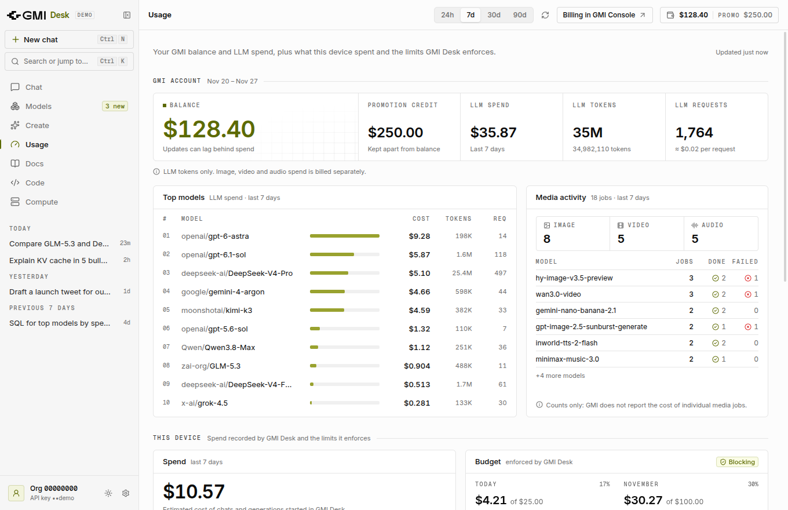

<div align="center">


# GMI Desk

**GMI Cloud, on your desktop.** Sign in once, and the live model catalog with your prices, chat, image/video/audio
generation, a coding agent, GPU compute and your usage are all in one window.

Unofficial community client in the style of [T3 Code](https://github.com/pingdotgg/t3code). Not an official GMI Cloud
product. Working name.



</div>

## What it does

| | |
|---|---|
| **Sign in with GMI** | OAuth 2.1 against GMI's own authorization server (PKCE, browser sign-in, refresh tokens). No API key needed for models, usage, media, docs or support. |
| **Models** | Every model on GMI (LLMs, image, video, audio, GMI Studio workflows) with *your* discounted prices, context sizes, inputs/outputs and leaderboard scores. Refreshes in the background, flags **New** models, and exports the catalog as an OpenCode provider (works inside T3 Code). |
| **Chat** | Threads with any GMI LLM: streaming, reasoning display, per-message tokens and cost. **Auto** lets **GMI Router** pick the model for each message. |
| **Create** | Forms generated from each model's parameter schema, a live cost estimate, approval before anything is charged, background polling and a local gallery. |
| **Code** | A coding agent on GMI models: projects, threads in git worktrees, a timeline of tool calls, approval cards, diff review, checkpoints, commit/merge. Commands run in a sandbox (bubblewrap on Linux, Seatbelt on macOS). |
| **Compute** | GPU containers (Cluster Engine) and Agentbox sandboxes with list prices in view, a cost guard, and a computer dock beside any page: terminal, files, ports and previews. |
| **Usage** | Balance, promotion credit, LLM spend by model, media activity, and **budgets enforced by the app** (GMI keeps charging below a zero balance). |
| **Docs & support** | Search GMI's documentation and file support tickets without leaving the app. |

<table>
  <tr>
    <td></td>
    <td></td>
  </tr>
  <tr>
    <td></td>
    <td></td>
  </tr>
</table>

<sub>Screenshots use the app's built-in demo data (`npm run dev:mock`).</sub>

## Credentials

GMI's sign-in does not include an inference permission yet, so **chat, GMI Router and the Code agent need one
inference API key** (GMI Console → API Keys). The **Connect chat** dialog walks you through it: it opens the console,
notices the key when you copy it, and asks before using it. The app validates the key with GMI, stores it in your OS
keychain (libsecret / Keychain / DPAPI via Electron `safeStorage`; Settings › Security shows the backend) and never
shows it again. Compute needs a separate Compute key (Settings › Compute key). Everything else works with the sign-in
alone. The day GMI's sign-in covers inference, chat switches to it by itself.

**Money:** nothing that costs money happens without a confirmation. Media shows its estimate first, compute shows the
hourly price, and the app enforces your daily/monthly budgets itself.

## Run it

Requires Node 22.12+ and git. Linux is the primary platform; macOS and Windows builds are untested.

```bash
git clone https://github.com/kunalsiyag/gmi-desk.git
cd gmi-desk
npm install
npm run dev:mock   # demo data, no GMI account needed
npm run dev        # your real GMI account
```

There are no packaged releases yet (AppImage/deb are next on the roadmap).

## Develop

```bash
npm run check      # typecheck (3 projects) + tests + production build; must pass before a PR
npm test           # unit tests (vitest)
npm run typecheck
node scripts/screenshots.mjs --name demo --pages "models,chat,usage#light"   # offscreen PNGs, demo data
```

Developer overrides: `GMI_DESK_MOCK=1` (demo data), `GMI_API_KEY` (inference key from the environment, development
only), `GMI_DESK_LOG_LEVEL=debug`, `GMI_DESK_USER_DATA=<dir>`, `GMI_DESK_DEVTOOLS=1` (DevTools in a production build).
A packaged app ignores all of them except `GMI_DESK_LOG_LEVEL`. The full list is in [AGENTS.md](AGENTS.md).

Coding agents: start with [AGENTS.md](AGENTS.md), then [docs/STATUS.md](docs/STATUS.md). Contributors:
[CONTRIBUTING.md](CONTRIBUTING.md).

## How it is built

Electron 45 · React 19 · Tailwind 4 · Base UI · TanStack Query · TypeScript 7 · Vite 8 · vitest · MCP TypeScript SDK.

The renderer is sandboxed and never touches the network or any secret; it talks to the main process over a typed IPC
bridge (`src/shared/contracts/`). The main process talks to GMI through:

- `https://mcp.gmicloud.ai/mcp`: GMI's MCP server (OAuth) for the catalog, billing summary, generation, docs, support
- `https://api.gmi-serving.com/v1`: OpenAI-compatible inference (Chat Completions, Responses API)
- `https://console.gmicloud.ai/api/v1/ie/recommendation/autoroute`: GMI Router
- GMI's public console feeds for prices, media models, featured models and the router leaderboard

The Code agent runs in an Electron utility process (`src/harness/`) with its own event store, permission engine and
sandbox. Details: [docs/ARCHITECTURE.md](docs/ARCHITECTURE.md), decisions: [docs/DECISIONS.md](docs/DECISIONS.md),
designs: [docs/design/](docs/design/).

## Status

Early. Everything is covered by unit tests and offscreen screenshots in both themes, and sign-in plus the live catalog
have been used with a real account. Not yet exercised live: token refresh and sign-out, paid media generation, the
router, live Code-agent turns and Compute launches. See [docs/STATUS.md](docs/STATUS.md) for the exact list.

## Roadmap

- Packaged builds (AppImage / deb first, then dmg / exe) with auto-update.
- **Agents tab:** GMI Agentbox sandboxes (launch, logs, terminal).
- The Code agent driving a Compute sandbox (sandbox MCP + the computer dock).
- A **"GMI" agent in the ACP Registry**: one-click GMI inside T3 Code, Zed and JetBrains.

### What would make it fully key-less (asks for GMI)

1. An inference scope on GMI's OAuth server (or a PKCE key-provisioning flow), so sign-in covers chat and the router.
   The proposal: [docs/GMI-ASK.md](docs/GMI-ASK.md).
2. OAuth access for Agentbox, Compute and GMI Router.
3. A read scope for subscriptions and credits (Coding Plan, Studio plans, media spend).
4. A documented model catalog endpoint with release dates and capability flags (tools, vision, reasoning format, max output).

## License

The code is [MIT](LICENSE) © 2026 Kunal Siyag.

The GMI Cloud name, the GMI logo and the Dino mascot (including the vector redraw in `src/renderer/components/brand/`
and the app icon in `build/`) belong to GMI Cloud and are used with GMI Cloud's permission. They are not covered by the
MIT license; forks should replace them.
